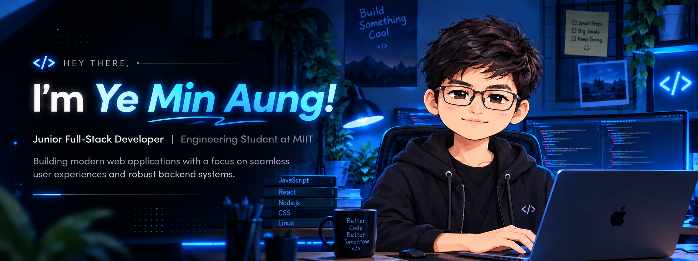

  

---

---

### About Me

- 🎓 **Education:** Engineering student at **Myanmar Institute of Information Technology (MIIT)**
- 💼 **Status:** Open to **Internship** and **Junior Developer** roles!
- 🛠️ **Tech Focus:** Modern frontend development, full-stack web applications, and API architecture
- 💡 **Motto:** *"Learn while you build and build while you learn."*
- 🤝 **Collaboration:** Eager to contribute to open-source projects and team builds. Ask me about React, Next.js, and Laravel!

---

<!-- Profile Views -->
<!-- 

  

 -->

### 💻 Languages & Frameworks

### 🛠️ Tools & Technologies

### 🚀 Deployment

### 🌐 Connect With Me

### GitHub Stats

<table border="0">
<tr>
  
<td>
  <picture>
    <source
      media="(prefers-color-scheme: dark)"
      srcset="https://github-readme-stats.vercel.app/api/top-langs?username=mryeminaung&layout=compact&hide_border=true&theme=tokyonight&border_radius=15"
    />
    <source
      media="(prefers-color-scheme: light)"
      srcset="https://github-readme-stats.vercel.app/api/top-langs?username=mryeminaung&layout=compact&hide_border=true&theme=default&border_radius=15"
    />
    
  </picture>
</td>
  
<td>
<picture>
  <source media="(prefers-color-scheme: dark)"
    srcset="https://streak-stats.demolab.com?user=mryeminaung&theme=tokyonight&hide_border=true&border_radius=15">
  <source media="(prefers-color-scheme: light)"
    srcset="https://streak-stats.demolab.com?user=mryeminaung&theme=default&hide_border=true&border_radius=15">
  
</picture>
</td>

<td>
<picture>
  <source media="(prefers-color-scheme: dark)"
    srcset="https://github-readme-stats.shion.dev/api?username=mryeminaung&show_icons=true&hide_border=true&theme=tokyonight&border_radius=15">
  <source media="(prefers-color-scheme: light)"
    srcset="https://github-readme-stats.shion.dev/api?username=mryeminaung&show_icons=true&hide_border=true&theme=default&border_radius=15">
  
</picture>
</td>

</tr>

</table>
<!-- <picture>
  <source media="(prefers-color-scheme: dark)"
    srcset="https://github-readme-activity-graph.vercel.app/graph?username=mryeminaung&theme=tokyo-night&hide_border=true&radius=15">
  <source media="(prefers-color-scheme: light)"
    srcset="https://github-readme-activity-graph.vercel.app/graph?username=mryeminaung&theme=github-light&hide_border=true&radius=15">
  
</picture> -->

### Just for Fun
<picture>
  <source media="(prefers-color-scheme: dark)" srcset="https://raw.githubusercontent.com/mryeminaung/mryeminaung/output/github-snake-dark.svg" />
  <source media="(prefers-color-scheme: light)" srcset="https://raw.githubusercontent.com/mryeminaung/mryeminaung/output/github-snake.svg" />
  
</picture>

<!--
**mryeminaung/mryeminaung** is a ✨ _special_ ✨ repository because its `README.md` (this file) appears on your GitHub profile.

&nbsp;

- 📫 How to reach me **yeminaung013@gmail.com**
Here are some ideas to get you started:
- 🤔 I’m looking for help with ...
- 💬 Ask me about ...
- 📫 How to reach me: ...
- 😄 Pronouns: ...
- ⚡ Fun fact: ...
--!>
